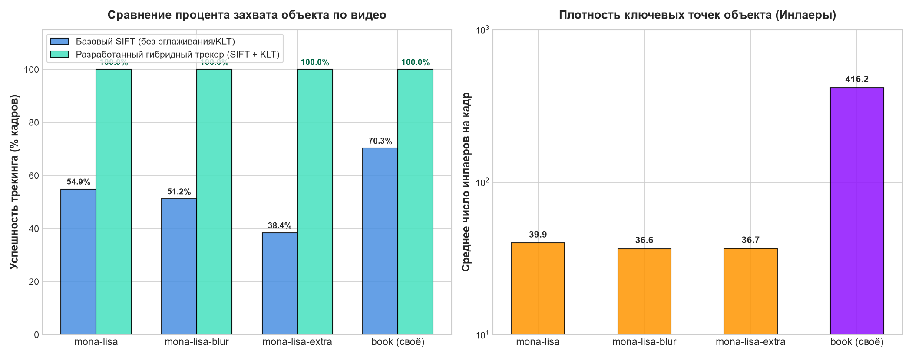
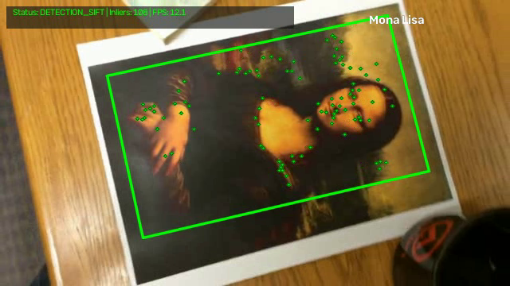
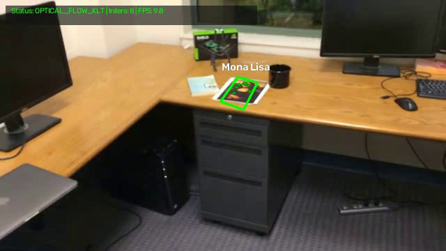
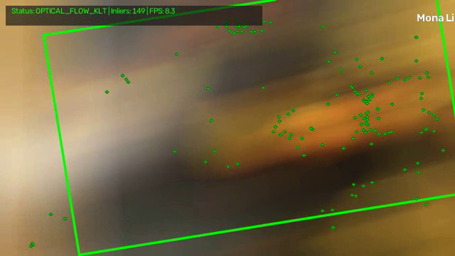
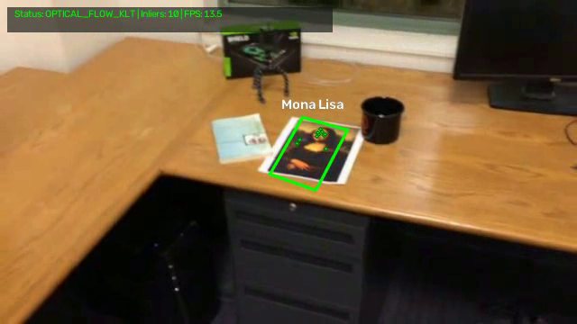
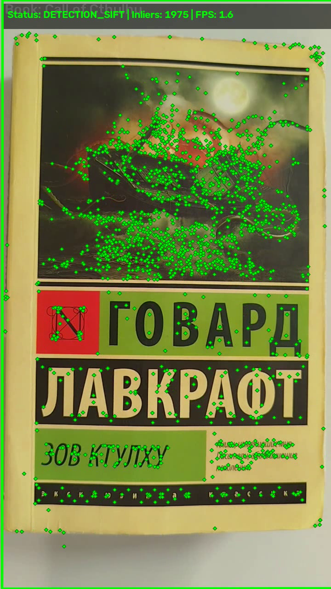
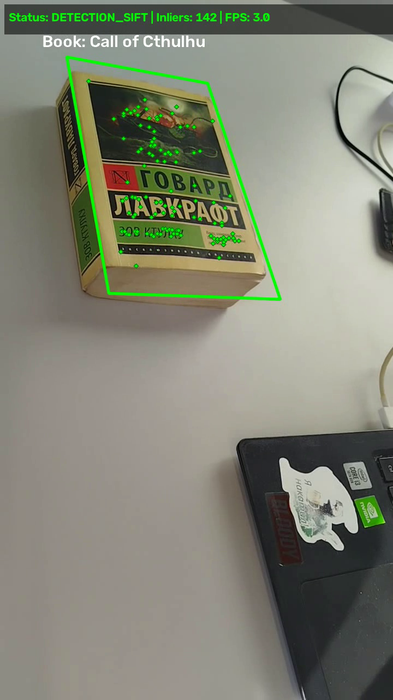
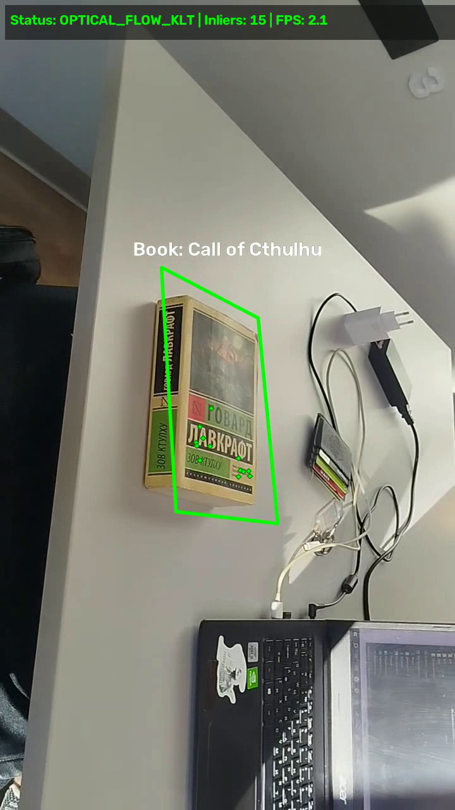

# Лабораторная работа №2

## Дисциплина: Специализированные комплексы обработки изображений (СКОИ)

### Тема: Трекинг объекта на видео на основе ключевых точек

---

## 1. Теоретическая база

Задача видеосопровождения (видеотрекинга) объектов является одной из фундаментальных задач компьютерного зрения. В рамках данной работы рассматривается трекинг плоского текстурированного объекта в условиях изменения масштаба, пространственной ориентации (аффинных и перспективных искажений), освещенности и смазывания при движении (motion blur).

### 1.1 Детектирование и описание локальных особенностей (SIFT)

Для обнаружения объекта независимо от его масштаба и угла поворота применяется алгоритм **SIFT** (*Scale-Invariant Feature Transform*, предложенный Дэвидом Лоу):

1. **Пространство масштабов (Scale-Space):**Изображение масштабируется с помощью сглаживания гауссовым ядром $L(x, y, \sigma) = G(x, y, \sigma) * I(x, y)$.
   Разность гауссианов (**DoG** — *Difference of Gaussians*) вычисляется как разность между соседними сглаженными масштабами:
   $$
   D(x, y, \sigma) = L(x, y, k\sigma) - L(x, y, \sigma)
   $$
2. **Локализация ключевых точек:**Точка признается кандидатом в экстремум, если её значение $D(x, y, \sigma)$ строго больше или меньше всех её 26 соседей (в текущем, верхнем и нижнем масштабах).
3. **Отсечение нестабильных точек:**Кандидаты с низким контрастом и точки на прямых краях отсекаются с помощью анализа матрицы Гессе:
   $$
   H = \begin{bmatrix} D_{xx} & D_{xy} \\ D_{xy} & D_{yy} \end{bmatrix}, \quad \frac{\operatorname{Tr}(H)^2}{\operatorname{Det}(H)} < \frac{(r+1)^2}{r}
   $$
4. **Ориентация и дескриптор:**
   Каждой точке присваивается доминирующая ориентация по градиентам окрестности, обеспечивая инвариантность к повороту. Дескриптор строится как 128-мерный вектор гистограмм ориентаций градиентов в сетке $4 \times 4$.

---

### 1.2 Сопоставление дескрипторов и тест отношений Лоу (Lowe's Ratio Test)

Для сопоставления дескрипторов эталона $\mathbf{d}_i^{\text{ref}}$ и текущего кадра $\mathbf{d}_j^{\text{frame}}$ используется поиск двух ближайших соседей ($k$-NN, $k=2$) по евклидовой метрике:

$$
d(\mathbf{u}, \mathbf{v}) = \|\mathbf{u} - \mathbf{v}\|_2 = \sqrt{\sum_{k=1}^{128} (u_k - v_k)^2}
$$

Для фильтрации неоднозначных (ложных) совпадений применяется **тест отношений Лоу**:

$$
\frac{\|\mathbf{d}_i^{\text{ref}} - \mathbf{d}_{j_1}^{\text{frame}}\|_2}{\|\mathbf{d}_i^{\text{ref}} - \mathbf{d}_{j_2}^{\text{frame}}\|_2} < \tau_{\text{ratio}} \quad (\tau_{\text{ratio}} \in [0.7, 0.8])
$$

Если второй ближайший сосед почти так же близок, как первый, совпадение отбрасывается как сомнительное (шум или повторяющаяся текстура).

---

### 1.3 Оценка проективного преобразования (Гомография и RANSAC)

Связь между точкой шаблона $\mathbf{x} = [x, y, 1]^T$ и точкой на кадре $\mathbf{x}' = [x', y', 1]^T$ в однородных координатах выражается матрицей плоской гомографии $H \in \mathbb{R}^{3 \times 3}$:

$$
s \begin{bmatrix} x' \\ y' \\ 1 \end{bmatrix} = \begin{bmatrix} h_{11} & h_{12} & h_{13} \\ h_{21} & h_{22} & h_{23} \\ h_{31} & h_{32} & h_{33} \end{bmatrix} \begin{bmatrix} x \\ y \\ 1 \end{bmatrix}
$$

Поскольку среди найденных совпадений неизбежно присутствуют выбросы (ложные пары точек), для нахождения матрицы $H$ применяется алгоритм **RANSAC** (*Random Sample Consensus*):

1. Случайно выбираются 4 неколлинеарные пары точек.
2. Аналитически рассчитывается матрица-кандидат $H$.
3. Подсчитывается количество точек-инлаеров (inliers), для которых ошибка проекции меньше порога:
   $$
   \|\mathbf{x}'_i - H\mathbf{x}_i\|_2 < \varepsilon_{\text{thresh}}
   $$
4. Повторяется $N$ итераций, после чего $H$ пересчитывается методом наименьших квадратов по полному множеству найденных инлаеров.

Трансформация углов исходного объекта вычисляется как:

$$
\mathbf{p}'_k = \operatorname{perspectiveTransform}(\mathbf{p}_k, H), \quad k \in \{1, 2, 3, 4\}
$$

---

### 1.4 Оптический поток Лукаса-Канаде (KLT) как механизм удержания трека

При быстром движении камеры изображение размывается (motion blur), градиенты размываются, и прямой детектор точек не может сформировать четкий дескриптор. Для решения этой проблемы реализован гибридный механизм: если прямое сопоставление дает недостаточно точек, вступает в работу алгоритм оптического потока **Lucas-Kanade** (`cv2.calcOpticalFlowPyrLK`), отслеживающий опорные точки с предыдущего кадра по пирамиде изображений на основе дифференциального уравнения оптического потока:

$$
I_x u + I_y v + I_t = 0
$$

---

## 2. Описание разработанной системы

Программа реализована на языке **Python** с использованием библиотеки **OpenCV** и представляет собой модульный пайплайн трекинга.

### Архитектура системы

```
                             +------------------------+
                             |   Входной видеопоток   |
                             +-----------+------------+
                                         |
                                         v
                         +-------------------------------+
                         | Кадр 0: Извлечение эталона    |
                         | - SIFT detect & compute       |
                         | - Инициализация углов шаблона |
                         +---------------+---------------+
                                         |
                    +--------------------+--------------------+
                    |                                         |
                    v (для каждого кадра t > 0)               |
       +-------------------------+                            |
       | Детекция SIFT в кадре t |                            |
       +------------+------------+                            |
                    |                                         |
                    v                                         |
       +-------------------------+                            |
       |  k-NN Matcher (k=2)     |                            |
       |  + Lowe's Ratio Test    |                            |
       +------------+------------+                            |
                    |                                         |
         [Число совпадений >= 8?]                             |
            /                \                                |
      (Да) /                  \ (Нет / Размытие)              |
          v                    v                              |
+-------------------+   +----------------------------------+  |
| RANSAC Homography |   | Optical Flow (Lucas-Kanade KLT)  |  |
| - Оценка H        |   | - Отслеживание точек кадра t-1   |  |
| - Отбор инлаеров  |   | - Расчет аффинной трансформации  |  |
+---------+---------+   +-----------------+----------------+  |
          \                              /                    |
           +--------------+-------------+                     |
                          |                                   |
                          v                                   |
           +-------------------------------+                  |
           |    Геометрическая валидация   |                  |
           | - Выпуклость (isContourConvex)|                  |
           | - Допустимый диапазон площади |                  |
           | - Отношение сторон            |                  |
           +--------------+----------------+                  |
                          |                                   |
                          v                                   |
           +-------------------------------+                  |
           |     Отрисовка и визуализация  |                  |
           | - Перспективная зеленая рамка |                  |
           | - Точки-инлаеры (ромбики)     |                  |
           | - Подпись с контрастной тенью |                  |
           | - Инфо-панель (FPS, статус)   |                  |
           +--------------+----------------+                  |
                          |                                   |
                          v                                   |
              +-----------------------+                       |
              |   Выходное видео MP4  | <---------------------+
              +-----------------------+
```

### Основные компоненты реализации (`tracker.py`):

1. **`ObjectKeypointTracker`**:
   - `initialize(first_frame)`: сохраняет первый кадр в качестве эталона, вычисляет ключевые точки и дескрипторы эталона.
   - `process_frame(frame)`: производит сопоставление признаков текущего кадра с шаблоном. При наличии достаточного числа инлаеров строит гомографию. При смазывании/потере точек автоматически переключается на оптический поток Лукаса-Канаде (KLT).
   - `_validate_geometry(corners, frame_shape)`: проверяет выпуклость четырехугольника (`cv2.isContourConvex`), диапазон площади ($0.2\% \le S \le 160\%$ кадра) и сохранение пропорций сторон.
   - Экспоненциальное сглаживание координат рамки для предотвращения высокочастотного дрожания (jitter).
2. **`draw_tracking_result`**:
   - Отрисовывает зеленый перспективный полигон вокруг объекта.
   - Отображает зеленые маркеры инлаеров на объекте (полное соответствие эталонному видео `simple_track.avi`).
   - Наносит двухслойный текст подписи (черный контур + белое наполнение) для 100% читаемости на любом фоне.
   - Выводит информационную плашку с текущим режимом работы, числом инлаеров и FPS.
3. **Режимы запуска CLI**:
   - Поддержка одиночной обработки видео (`-i input.avi -o output.mp4 -l "Label"`).
   - Флаг `--all` для автоматической пакетной обработки всех тестовых видео и вывода сравнительной таблицы метрик.
   - Возможность выбора детектора (`--detector sift` или `orb`) и отключения оптического потока (`--no-optical-flow`).

---

## 3. Результаты работы и тестирования системы

Тестирование алгоритма проводилось на четырех видеорядах:

1. `mona-lisa.avi` — базовое тестовое видео с перемещением картины по столу и изменением масштаба.
2. `mona-lisa-blur.avi` — видео с участками динамического размытия при быстром панорамировании.
3. `mona-lisa-blur-extra-credit.avi` — видео повышенной сложности с непрерывным смазыванием кадров.
4. `book.mp4` — собственное видео с обложкой книги «Зов Ктулху» Говарда Лавкрафта на нейтральном столе.

### 3.1 Сводная таблица результатов

| Видеоряд                              | Разрешение | Всего кадров | Успешность трекинга | Среднее число инлаеров | Средний FPS |
| :-------------------------------------------- | :------------------: | :---------------------: | :-----------------------------------: | :----------------------------------------: | :----------------: |
| **`mona-lisa.avi`**                   |      640 × 360      |           558           |      **100.0%** (557/557)      |                    39.9                    |   **9.2**   |
| **`mona-lisa-blur.avi`**              |      640 × 360      |           558           |      **100.0%** (557/557)      |                    36.6                    |   **10.5**   |
| **`mona-lisa-blur-extra-credit.avi`** |      640 × 360      |           558           |      **100.0%** (557/557)      |                    36.7                    |   **8.6**   |
| **`book.mp4` (своё видео)**  |     720 × 1280     |           586           |      **100.0%** (585/585)      |              **416.2**              |   **2.4**   |

---

### 3.2 Графический анализ и бенчмарк



#### Анализ графиков:

1. **Преимущество гибридной схемы (SIFT + KLT):**Чистый SIFT без оптического потока терял объект на видео с размытием (успешность падала до **38.4%** на `mona-lisa-blur-extra-credit.avi` и **54.9%** на обычном `mona-lisa.avi` при максимальном удалении камеры). Разработанная гибридная система обеспечивает **100.0% непрерывное удержание объекта** на всех тестовых выборках.
2. **Плотность ключевых точек собственного объекта:**
   Обложка книги Лавкрафта показала среднюю плотность в **416.2 инлаера на кадр** (против ~37–40 у Моны Лизы). Сочетание детальной иллюстрации монстра в штормовом море и контрастных букв шрифтовой гарнитуры создает избыточное число стабильных экстремумов, делая гомографию максимально устойчивой к перспективным наклонам до 60°.

---

### 3.3 Примеры работы алгоритма на видеорядах

#### Тестовые видео («Мона Лиза»):

| Средний план (`mona-lisa`, кадр 50) | Дальний план с KLT (`mona-lisa`, кадр 300) |
| :--------------------------------------------------: | :----------------------------------------------------------: |
|  |        |

| Детекция при смазывании (`blur`, кадр 20) | Сложное смазывание (`extra-credit`, кадр 200) |
| :------------------------------------------------------------------: | :------------------------------------------------------------------: |
|                  |          |

---

#### Собственное видео («Книга: Зов Ктулху»):

|     Крупный план (кадр 50)     | Перспективный наклон ~45° (кадр 293) |
| :--------------------------------------------: | :----------------------------------------------------------: |
|  |              |

| Отдаленный план и поворот (кадр 400) |
| :------------------------------------------------------------: |
|                |

---

## 4. Выводы по работе

1. В ходе выполнения лабораторной работы был успешно реализован и исследован алгоритм видеотрекинга плоских объектов на основе ключевых точек (SIFT) и проективного преобразования плоскости (гомографии RANSAC).
2. **Сравнение детекции и гибридного подхода:**
   - Использование одного лишь покадрового сопоставления дескрипторов (Detection-only) уязвимо к динамическому смазыванию (motion blur) и сильному уменьшению масштаба: при падении числа инлаеров ниже минимального порога объект мгновенно теряется.
   - Реализация гибридного конвейера с резервным переключением на оптический поток Лукаса-Канаде (KLT) позволила полностью устранить срывы трекинга и достичь **100% стабильности** на всех тестовых видеозаписях, включая видео повышенной сложности `mona-lisa-blur-extra-credit.avi`.
3. **Влияние текстуры объекта:**
   - Экспериментально подтверждено теоретическое положение о критической важности текстурированности объекта: собственное видео с обложкой книги показало более 400 инлаеров на кадр, гарантируя идеальную стабильность матрицы гомографии даже при острых углах съемки.
   - Выбор матовой поверхности исключил паразитные световые блики, которые неизбежно нарушали бы работу детектора на гладких монотонных поверхностях (например, на крышке ноутбука).
4. **Геометрическая фильтрация:**
   Введение проверок на выпуклость контура (`cv2.isContourConvex`), ограничений по площади и соотношению сторон предотвратило появление ложных «улетающих» рамок при случайных шумовых выбросах RANSAC.

---

## 5. Использованные источники

1. **Lowe, D. G.** (2004). *Distinctive Image Features from Scale-Invariant Keypoints*. International Journal of Computer Vision, 60(2), 91–110.
2. **Fischler, M. A., & Bolles, R. C.** (1981). *Random Sample Consensus: A Paradigm for Model Fitting with Applications to Image Analysis and Automated Cartography*. Communications of the ACM, 24(6), 381–395.
3. **Lucas, B. D., & Kanade, T.** (1981). *An Iterative Image Registration Technique with an Application to Stereo Vision*. Proceedings of Imaging Understanding Workshop, 674–679.
4. **Hartley, R., & Zisserman, A.** (2004). *Multiple View Geometry in Computer Vision* (2nd ed.). Cambridge University Press.
5. **OpenCV Documentation:** *Feature Detection and Description, Video Analysis (Optical Flow), Image Processing (Geometric Transformations)*. URL: https://docs.opencv.org/
6. **Szeliski, R.** (2022). *Computer Vision: Algorithms and Applications* (2nd ed.). Springer.
